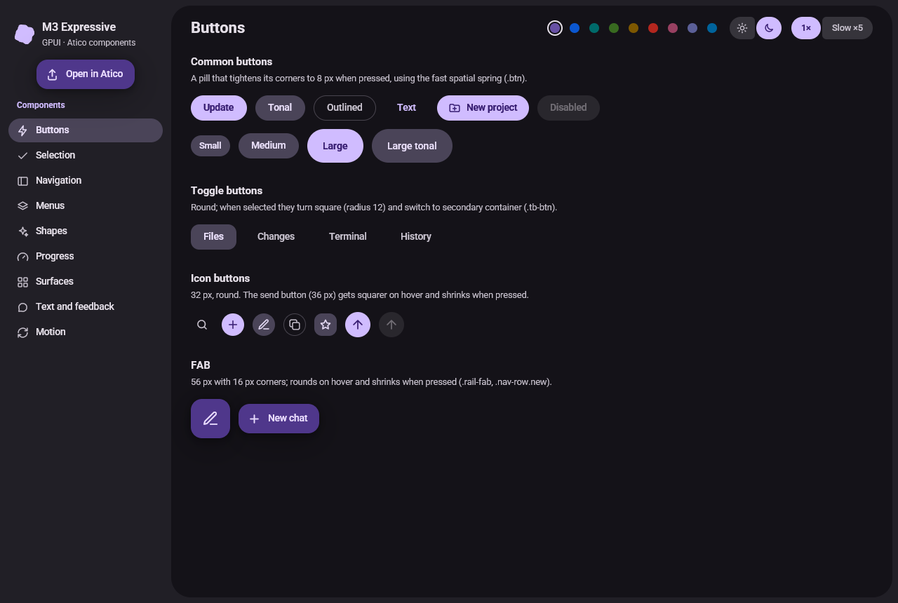
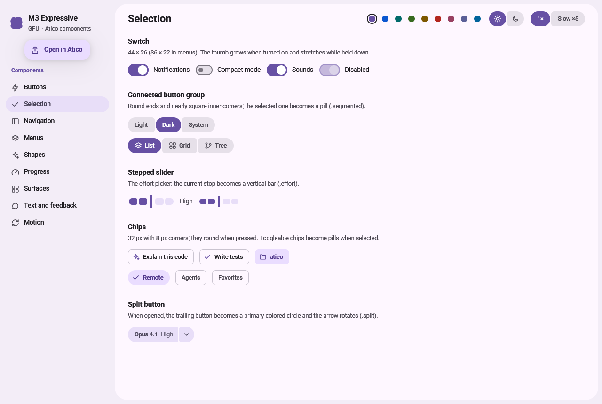
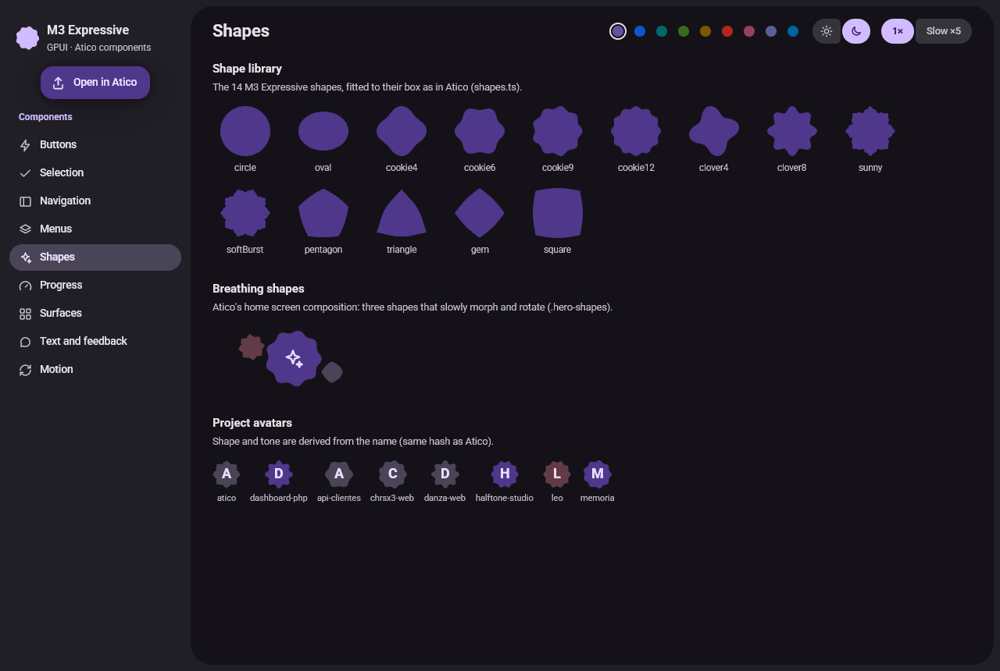
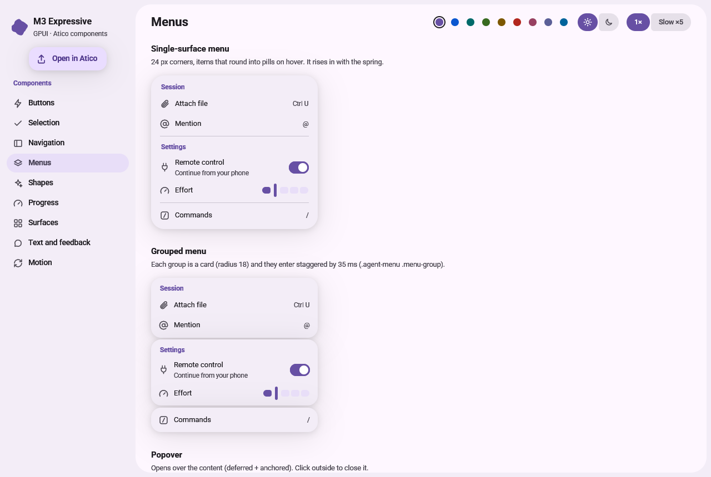
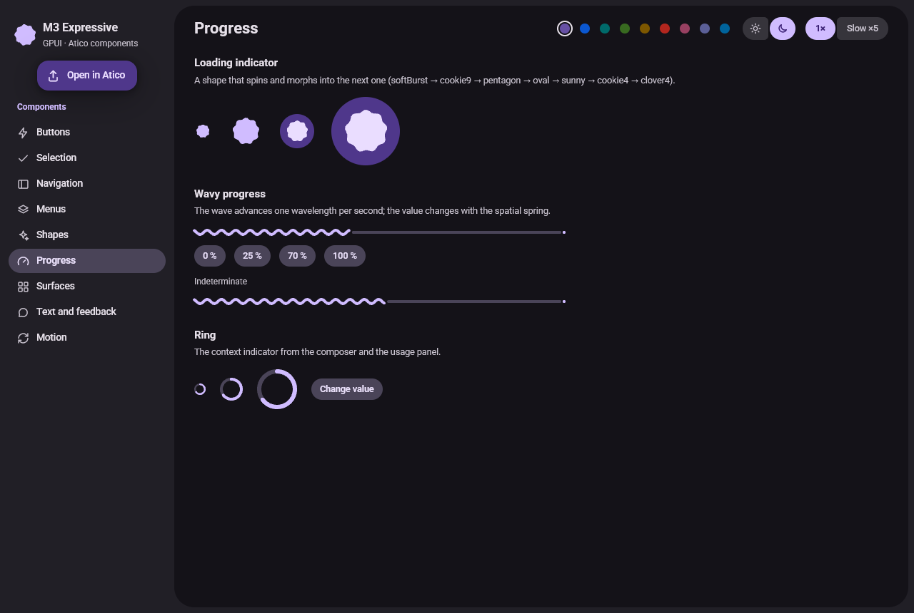
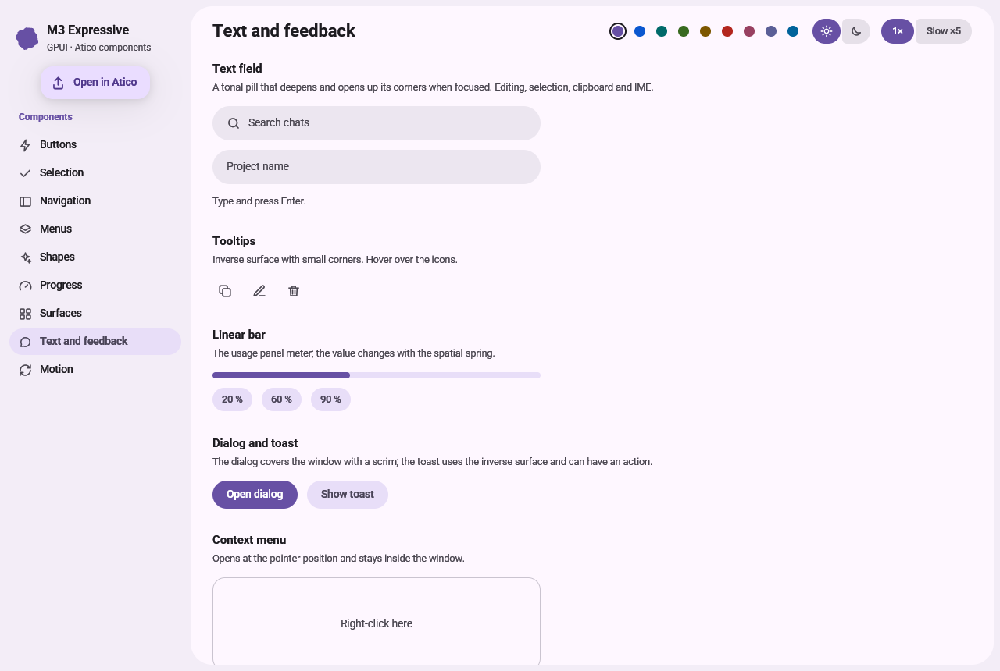

# gpui-m3

**Material 3 Expressive components for [GPUI](https://gpui.rs)**, the GPU-accelerated UI framework
behind the Zed editor.

Shape morphing, physical spring motion, ripples, dynamic color and the M3 Expressive shape library —
built natively for GPUI, no web view involved.



| | |
|---|---|
|  |  |
|  |  |
|  | |

## Try it

```bash
git clone https://github.com/chrx3/gpui-m3
cd gpui-m3
cargo run --example gallery
```

The gallery shows every component with light/dark mode, nine seed colors and a **Slow ×5** switch to
inspect the motion. The first build compiles GPUI and takes a few minutes. `M3_SECTION=<n>` opens a
section directly and `M3_SIZE=<width>x<height>` sets the window size (handy for screenshots).

## Install

```toml
[dependencies]
gpui = "0.2.2"
gpui-m3 = "0.1"
```

```rust
use gpui::*;
use gpui_m3::{Button, Switch, Theme};

fn main() {
    Application::new().with_assets(gpui_m3::Assets).run(|cx: &mut App| {
        gpui_m3::init(cx); // font, key bindings, light baseline theme
        Theme::set(true, Some(gpui_m3::theme::hex("#0b57d0")), cx); // dark, dynamic color
        // open your window...
    });
}

// In a render method:
div()
    .font_family(gpui_m3::theme::FONT_FAMILY)
    .child(Button::new("save", "Save").filled().on_click(|_, _, _| {}))
    .child(Switch::new("wifi", self.wifi).on_toggle(/* ... */))
```

Components are `RenderOnce` and keep their animation state between frames, so **each one needs an id
that is unique within its view**, like any stateful GPUI element. `TextField` is the exception: it is
an entity you create once (`cx.new(|cx| TextField::new(cx))`) and keep in your view.

## Components

| Group | Components |
|---|---|
| Buttons | `Button` (filled, tonal, outlined, text, ghost; 6 sizes; toggle, sublabel, confirmation), `IconButton` (tooltip, launch), `Fab`, `FavStar` |
| Selection | `Switch`, `SegmentedButtons`, `StopSlider`, `Slider`, `Chip` (assist, filled, filter, input, tonal, small), `SplitButton`, `Badge`, `Radio`, `Checkbox`, `ChoiceRow`, `MorphDot` |
| Navigation | `NavItem` (drawer rows), `RailItem`, `IconTabs`, `TabStrip`, `TreeRow`, `ListItem` |
| Text & feedback | `TextField` (pill, compact, inline, bare, filled, outlined), `TextArea` (multi-line), `CommandPalette`, `SuggestionList` (@-mentions, with `SuggestionNav`, `match_ranges`, `rank_mentions`), `Dialog`, `Toast`, `Tooltip`, `context_menu`, `Banner`, `DividerLabel` |
| Surfaces | `Menu` (header, back row, scrolling), `MenuItem` (dense, radio, danger, shortcuts), `Popover`, `Card`, `ExpandableCard`, `ListGroup`, `Bubble` |
| Shapes & progress | `Shape` (14 shapes, breathe, breathe on hover, photo fill, spin), `Avatar` (initials or a photo), `LoadingIndicator`, `WavyProgress`, `Ring`, `LinearProgress` |
| Attachments | `DropZone` (files from the system), `ImageThumb` |
| Code | `Markdown` (GFM: tables, tasks, nested lists, quotes, links, paths; parsed with `pulldown-cmark` and cached), `CodeBlock` (language name, Copy → Copied, highlighting), `CodeOutput` (clipped tool output), `DiffView` / `Diff` (real line diff with `similar`, folding, `+N −M`), `DiffBar` |
| Appearance | `SelectCard`, `ColorSwatches`, `HsvPicker` |
| Foundations | `theme` (`Scheme`, `Theme`, `corner`), `syntax` (`SyntaxHighlighter` line by line, `SyntaxPalette`), `motion` (`Spring`, `animate*`, `entrance`, `presence`, `play_on_rise`), `Presence` (exit animations), `shapes`, `interaction` (state layer, ripples, focus ring) |

## Theming

- `Theme::set(dark, None, cx)` uses the M3 baseline (purple) scheme.
- `Theme::set(dark, Some(seed), cx)` generates a scheme from any color (tonal spot, via
  [`material-colors`](https://crates.io/crates/material-colors)).
- `Theme::set_scheme(scheme, dark, cx)` uses your own colors — handy when your app already has
  design tokens. See [docs/INTEGRATING.md](docs/INTEGRATING.md).

### Syntax colors

`CodeBlock` and `SyntaxHighlighter` reduce tokens to a few kinds (keyword, string, function, type,
comment, number, meta) painted with a `SyntaxPalette` derived from the scheme: keywords in
`primary`, strings in `success`, types in `tertiary`, comments in `outline`, numbers in
`warning`. `SyntaxPalette::set(Some(palette), cx)` uses your own colors.

Highlighting uses [syntect](https://crates.io/crates/syntect) with its bundled Sublime Text
syntaxes and the pure-Rust regex engine (no C toolchain), plus compact grammars for TypeScript,
TOML and PowerShell. It works line by line with a cloneable state, so an editor can re-highlight
from the edited line.

## Motion

M3 Expressive motion is spring-based. GPUI's `with_animation` only accepts easing curves that stay
within 0–1, so `gpui-m3` solves damped springs analytically, using the official
`MotionScheme.expressive()` values from Jetpack Compose:

| Spring | Stiffness | Damping | Used for |
|---|---|---|---|
| `SPATIAL_FAST` / `SPATIAL` / `SPATIAL_SLOW` | 800 / 380 / 200 | 0.6 / 0.8 / 0.8 | position, size, shape (bouncy) |
| `EFFECTS_FAST` / `EFFECTS` / `EFFECTS_SLOW` | 3800 / 1600 / 800 | 1.0 | color, opacity (no bounce) |

Retargeting mid-flight keeps the current velocity, so rapid clicks feel continuous. Use the same
helpers in your own components:

```rust
let radius = gpui_m3::motion::animate_px("card-radius", Spring::SPATIAL_FAST, target, window, cx);
```

`MotionSettings { reduced: true, .. }` turns all motion off; `time_scale` slows it down for review.

## Performance

- **Build GPUI optimized.** Unoptimized GPUI is 3–5× slower. Copy the `[profile.dev]` sections from
  this crate's `Cargo.toml` into your app (dependencies at `opt-level = 3`).
- **Continuous animations re-render their view and every ancestor view each frame.** Keep loading
  indicators and breathing shapes in small views, and wrap large static siblings in cached views
  (`AnyView::from(entity).cached(style)`), as the gallery does.
- **Every animated shape, wave or ring is a path that GPUI rasterizes each frame** (~4% of a core on
  an integrated GPU). Avoid many at once. Slow ambient motion runs at 30 fps (`motion::continuous_at`).

With nothing animating, the gallery does not redraw at all.

## Differences from the web version of M3 Expressive

- GPUI cannot scale arbitrary elements, so press "shrink" effects resize the component instead, and
  menus enter by rising and fading without the `scale(0.9)`.
- GPUI clips only to rectangles; ripples are drawn as the intersection of a circle and the
  component's rounded rectangle.
- `material-colors` 0.4 implements the 2021 dynamic color spec (0.5 requires Rust 1.97).
- Roboto ships as a variable font with weights; width axes (`font-stretch`) are not available in GPUI.
- Monospace text uses the platform font (Consolas, Menlo or DejaVu Sans Mono); none is bundled.
- GPUI does not select text, so `Markdown` offers no selection; put a Copy action next to it.

## Roadmap

- `SuggestionList`: animate rows that appear while typing by identity, not by position.
- Focus rings on the other clickable components (buttons, menu items, rows).
- `CodeEditor`: code folding and multiple cursors.
- Syntax colors inside `DiffView` lines, and a side-by-side diff.
- `Markdown`: selectable text, hover underline on links, footnotes and math.

## Status

`0.1` is young. It is developed and tested on Windows; CI builds it on macOS and Linux. GPUI itself is
pre-1.0 and changes its API between versions, so `gpui-m3` tracks `gpui 0.2.x`.

## Credits

- Text editing in `TextField` is based on GPUI's `examples/input.rs` (Apache-2.0).
- Motion values from Jetpack Compose Material 3 (Apache-2.0).
- Syntax highlighting by [syntect](https://github.com/trishume/syntect) (MIT) and its bundled
  Sublime Text syntaxes; Markdown parsing by
  [pulldown-cmark](https://github.com/pulldown-cmark/pulldown-cmark) (MIT); diffs by
  [similar](https://github.com/mitsuhiko/similar) (Apache-2.0).
- Roboto by The Roboto Project Authors, under the [SIL Open Font License 1.1](assets/fonts/OFL.txt).
- "Material Design" is a trademark of Google. This project is not affiliated with or endorsed by Google.

## License

Code licensed under either of [MIT](LICENSE-MIT) or [Apache-2.0](LICENSE-APACHE), at your option.
The bundled Roboto font is licensed under the [OFL 1.1](assets/fonts/OFL.txt).
